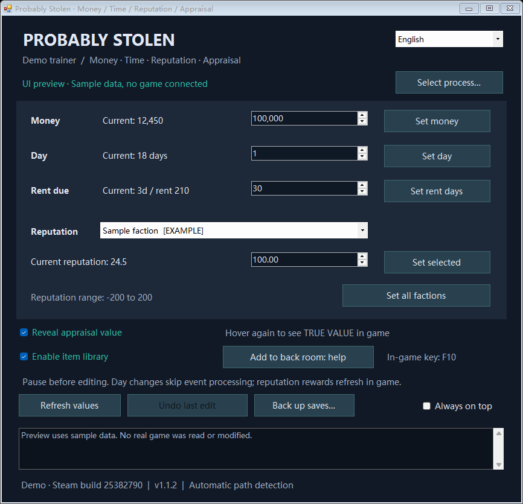
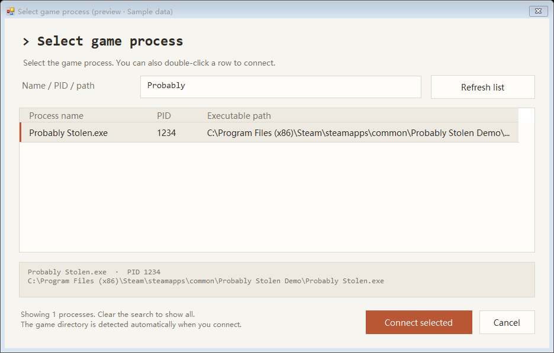

# Probably Stolen Trainer v1.1.2

[简体中文](README.zh-CN.md) · **English** · [Changes / 更新记录](CHANGELOG.md)

**v1.1.2 fixes the reputation-type lookup that caused the reported connection failure.** It validates the class of loaded reputation objects instead of treating an unresolved type token as a pointer. Automatic diagnostics and the existing item library are included; see [the changelog](CHANGELOG.md).

A portable Windows x64 trainer for **Probably Stolen Demo, Steam build 25382790**. Switch between Simplified Chinese and English without disconnecting. No Cheat Engine or mod loader is required.

**Compatibility:** this release checks the SHA-256 of both game binaries before connecting. It supports the exact Demo build below; it does not claim compatibility with the full game or later updates.

**Validation status:** 60 automated checks passed, including a reproduction of the original failure using the token from live-game logs, synthetic game objects, connection diagnostics, native Win32 memory operations in isolated test processes, and language switching. Both languages were rendered and checked. **Successful connection and gameplay behavior in v1.1.2 still need live-game confirmation.**



## Quick start

1. Extract `ProbablyStolenTrainer-v1.1.2-win-x64.zip` and run `ProbablyStolenTrainer.exe` on Windows 10/11 with .NET Framework 4.8.
2. Start the Demo through Steam and load a save into the shop. Run the trainer in the **same Windows system, user and privilege level** as the game.
3. Use **Back up saves…** before editing. Pause the game, click **Select process…**, and select `Probably Stolen.exe`. Search by name, PID or path; refresh the list after starting the game. Double-clicking a row also connects.
4. Check the displayed current values, enter a new value, and press the matching **Set** button.
5. To reveal appraisal values, enable **Reveal appraisal value**, move the mouse away from the item, and hover again. The game's tooltip should include its native `TRUE VALUE : <number>` line.
6. To add stock to the back room, enable the item menu and follow [the item-library instructions](#adding-items-to-the-back-room).

Use the **简体中文 / English** selector at the top right to change language immediately. The choice is saved in `%LOCALAPPDATA%\ProbablyStolenTrainer\language.txt`. First launch follows the Windows UI language: Chinese for a Chinese UI, English otherwise. Game-provided faction names and the native `TRUE VALUE` line are unchanged. Previous log entries stay in the language in which they were created.

## Features

| Feature | Behavior / range |
| --- | --- |
| Process picker | Search, refresh, PID and path display; automatic game directory detection |
| Money | Integer from 0 to 999,999,999 |
| Day | Date counter from 0 to 99,999 |
| Rent countdown | Days remaining from 0 to 9,999; rent amount is unchanged |
| Reputation | One selected faction or all factions; -200 to 200, with two decimal places |
| Appraisal value | Toggle the game's own true-value tooltip for supported appraisal items |
| Back-room items | Open the native item library using the displayed game shortcut, then drag items into free warehouse space |
| Undo | Undo the last successful numeric edit while the save, objects and edited values still match |
| Save backup | ZIP the selected folder's on-disk `.es3` files into `backups` beside the trainer |
| Languages | Chinese / English UI, process picker, application messages and errors; remembered preference |
| Other controls | Refresh values and keep the window on top |

## Drive letters and multiple Windows installations

No C: or D: path is hardcoded for connecting. The trainer finds `GameAssembly.dll` in the selected process's loaded modules. Use it inside the Windows installation currently running the game; it cannot attach to an inactive operating system. The detected directory is shown in the trainer log.



## Appraisal display

The toggle uses the game's existing appraisal calculation (`AppraisalHelper.GetCorrectBaseValue`) and displays the result in its normal tooltip. It applies to items marked as appraisal items for which this build provides a calculation. Ordinary merchandise is unaffected. The value is the appraisal base value, **not the final retail or negotiated sale price**.

The toggle starts off. It changes one verified branch-displacement byte in process memory; it does not enable global developer mode, edit item prices, submit an appraisal, modify game files or save the toggle to disk. Unchecking it, changing the connection or closing the trainer normally restores the original tooltip logic. Hover again to refresh an already open tooltip.

If the trainer is forcibly terminated, the display change may remain until the game exits. Restart the game to restore it. If another tool changes the same code, restoration is refused rather than overwriting that tool's changes; the trainer reports this condition.

## Adding items to the back room

1. Back up the save, enter the shop and connect the trainer. Keep the back-room inventory visible with enough free space.
2. Check **Enable item library**. The trainer reads and displays the shortcut configured in this game instance; the F10 shown in the screenshot is sample data.
3. Return focus to the game and press that shortcut to open **Debug Item Library**. Drag the desired item into the back-room inventory using the game's normal placement controls.
4. Press the same shortcut to close the library **before** disabling the toggle, disconnecting or closing the trainer. If you disabled it with the library still open, enable it again and use the shortcut to close it.

This opens the game's existing library; it does not provide an item-ID or quantity input box. Native templates start with 10 units, and the game's drag, split and stack behavior determines the amount placed. Templates replenish, allowing repeated transfers. The library may contain internal or quest items; use familiar merchandise first. Added items follow normal game saving and are not removed by the numeric **Undo** button or by disabling the menu.

The toggle validates the shop, library objects and two code signatures, then changes both code regions as one operation while briefly suspending the process. It restores the original code on disable or normal disconnect/exit. Other debug commands in this handler are skipped while enabled; global developer mode and game files are unchanged. If the menu is busy, release the keys and retry. Restoration does not automatically close an already visible library window.

## What edits do

- **Day edits change the counter only.** They do not replay sleep, rent payments, skipped story events or reverse events that already happened. Rent days are set separately.
- **Reputation edits change the score only.** The game may need a UI refresh or related gameplay action before rewards, titles or privileges update. The exact refresh timing is not yet verified in a live session.
- **Undo is limited to the most recent numeric edit.** It is refused if the game has since changed an edited value or loaded another save/scene. It is not a full save restore.
- Numeric edits may be saved by the game's normal saving system. Closing the trainer does not undo saved numeric changes. Pause during edits and reconnect after a scene/save change.
- Numeric change logs are saved in `logs` beside the trainer. A log-write failure does not reverse an otherwise successful edit.

## Backups and restore

The usual save folder is:

```text
%USERPROFILE%\AppData\LocalLow\Questing Goose Studio\Probably Stolen
```

Choose the folder containing `save_0.es3`, `save_1.es3`, etc. The backup contains `.es3` files currently on disk; unsaved progress is not included. To restore, exit the game and extract the backup into the original save folder. Resolve any Steam Cloud conflict according to which copy you intend to keep.

## Troubleshooting

- **Object read failed after version verification:** the dialog now identifies the failed field and shows the path to a `connection-*.txt` report. Reports normally go into `logs` beside the trainer, with `%LOCALAPPDATA%/ProbablyStolenTrainer/logs` as a fallback. Use the latest report when reporting the failure. Diagnostic probes only read memory; reports contain pointer addresses and errors, not save-string values or item contents.
- **No game in the list:** launch it in the same Windows system, refresh, or clear the search filter.
- **No GameAssembly.dll:** select the actual game process, not a launcher, after a save has loaded.
- **Objects not ready:** enter the shop rather than staying in the main menu.
- **Version mismatch:** this build is unsupported; connection stops before any write.
- **Access denied:** use the same Windows account and privilege level for the trainer and game.
- **Save/scene changed:** wait until loading finishes, then select the process again.
- **Appraisal signature mismatch:** restart the game and confirm the supported build. A forced trainer exit or another tool may have changed the tooltip code.

## Build and test

Run in Windows PowerShell from the repository root:

```powershell
./build.ps1
./test.ps1
```

The build uses the x64 .NET Framework C# compiler under `%WINDIR%\Microsoft.NET\Framework64\v4.0.30319`; no NuGet dependencies or separate .NET SDK are needed. `test.ps1` runs tests in a separate process and writes `test-results.txt`. Tests use synthetic game data and memory allocated in the test process and its own disposable helper; they do not attach to the game or alter saves. See [the test scope](docs/TESTING.md).

Preview commands use sample data and do not connect to the game or persist a language override:

```powershell
./ProbablyStolenTrainer.exe --language en --render-preview preview-en.png
./ProbablyStolenTrainer.exe --language zh-CN --render-picker picker-zh-CN.png
```

## Supported binary profile

| File | SHA-256 |
| --- | --- |
| `GameAssembly.dll` | `3BEA17EEEC77ADAB6418918C28A8AA9A06F290582A2972639A48BD7E5A01AB44` |
| `Probably Stolen_Data/il2cpp_data/Metadata/global-metadata.dat` | `EFDCA95772FDCE327B51E0C7E8D320E7055917BE5C669DB47C1F7B36389F1F41` |

Updating the hashes alone is insufficient for a new game version; addresses, object layouts, tooltip code and runtime behavior must be rechecked.

This is an unofficial fan utility, not affiliated with the game's developer or Steam. This repository contains the trainer's source and documentation, not game binaries, assets, saves, decompiled game source or analysis tools.
