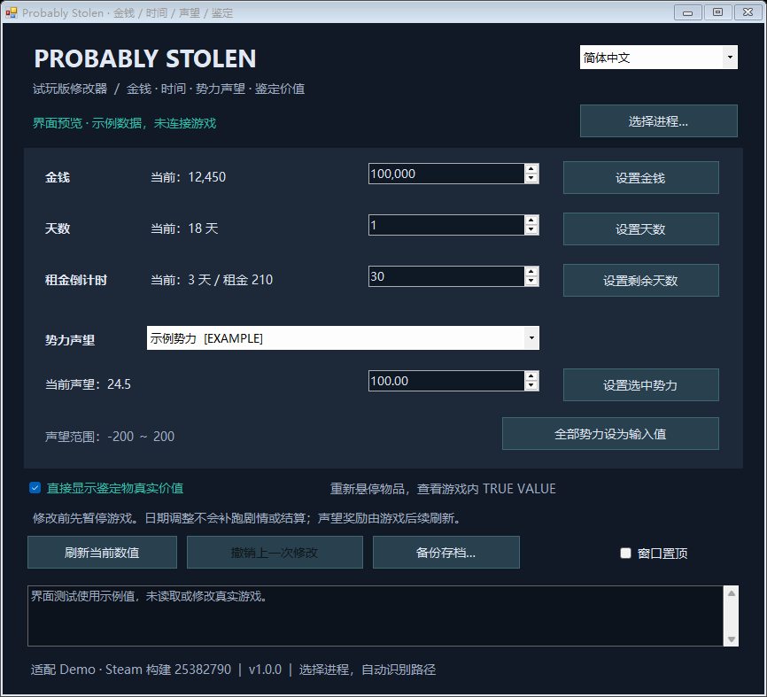
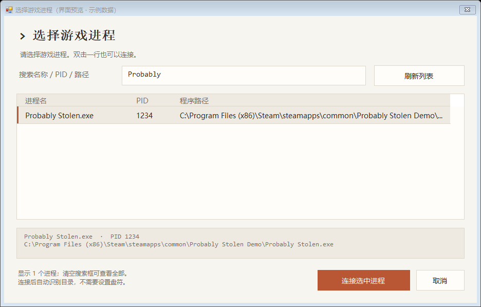

# 深空当铺：可能是偷的（Probably Stolen）修改器 v2.0.0

**简体中文** · [English](README.md) · [更新记录](CHANGELOG.md)

**v2.0.0 更换了新 UI。** 主窗口和进程选择器均已更新；主窗口支持调整大小，空间不足时可滚动操作。保留现有游戏功能与 v1.1.2 的连接修复，详见[更新记录](CHANGELOG.md)。

适用于 **《深空当铺：可能是偷的》（Probably Stolen）试玩版，Steam 构建 25382790** 的 Windows x64 便携修改器。支持中英文即时切换，无需断开游戏连接，也无需 Cheat Engine 或模组加载器。

**兼容范围：** 每次连接前都会核对游戏程序与元数据的 SHA-256，仅支持下方列出的试玩版构建，不保证支持正式版或后续更新。

**验证状态：** 已通过 61 项自动测试，覆盖原连接故障回归、模拟游戏对象、连接诊断、Win32 内存操作、语言切换和小窗口滚动；中英文界面及未连接状态均已渲染检查。**用户已确认 v1.1.2 在游戏中可用，2.0 的新版界面与全部功能尚未逐项完成独立实机验证，高 DPI 环境也未穷举测试。**

**仅供学习，欢迎大家反馈。** 详见 [v2.0.0 发布说明](docs/releases/v2.0.0.md)，问题与建议可提交到 [GitHub Issues](https://github.com/KyleY7/probably-stolen-trainer/issues)。



## 快速开始

1. 从 [v2.0.0 发布页](https://github.com/KyleY7/probably-stolen-trainer/releases/tag/v2.0.0)下载并解压 `ProbablyStolenTrainer-v2.0.0-win-x64.zip`，运行 `ProbablyStolenTrainer.exe`。需要 Windows 10/11 和 .NET Framework 4.8，先退出旧修改器再启动新版。
2. 从 Steam 启动试玩版，读入存档并进入店铺。修改器与游戏须在**同一套 Windows、同一用户与权限级别**下运行。
3. 先用**备份存档…**保留副本。暂停游戏，点击**选择进程…**，选中 `Probably Stolen.exe`。支持搜索名称、PID、路径和刷新列表；双击一行也能连接。
4. 核对当前值，输入目标值，点击对应的设置按钮。
5. 要查看鉴定价值，勾选**直接显示鉴定物真实价值**，把鼠标移开物品后重新悬停。游戏原生提示中应出现 `TRUE VALUE : 数字`。
6. 要向后仓添加物品，勾选**开启物品添加菜单**，按下方“向店铺后仓添加物品”的步骤操作。

窗口右上角的 **简体中文 / English** 选择框可立即切换语言，偏好保存在 `%LOCALAPPDATA%\ProbablyStolenTrainer\language.txt`。首次启动时，中文 Windows 界面默认中文，其他语言默认英文。游戏提供的势力名称和原生 `TRUE VALUE` 字样保持原样；已有日志保留写入时的语言。

## 功能

| 功能 | 行为与范围 |
| --- | --- |
| 选择进程 | 搜索、刷新、显示 PID 和路径，自动识别游戏目录 |
| 金钱 | 0～999,999,999 的整数 |
| 天数 | 日期计数，0～99,999 |
| 租金倒计时 | 剩余天数，0～9,999；不改变租金金额 |
| 势力声望 | 修改选中势力或全部势力；-200～200，可输入两位小数 |
| 鉴定价值 | 开关控制游戏原生真实价值提示，适用于支持的鉴定物 |
| 后仓添加物品 | 按显示的游戏快捷键打开原生物品库，将物品拖入仓库空位 |
| 撤销 | 存档、对象和目标值未发生变化时，撤销最近一次数值修改 |
| 存档备份 | 将选定目录中已写入磁盘的 `.es3` 文件压缩到程序旁的 `backups` |
| 中英文 | 界面、进程选择、程序提示与错误信息，记忆语言偏好 |
| 其他 | 刷新当前值、窗口置顶 |

## 盘符与双系统

连接不依赖固定的 C 盘或 D 盘路径。程序从所选进程已加载的 `GameAssembly.dll` 获取实际目录，并显示在日志中。请在**正在运行游戏的那套 Windows** 内启动修改器，不能连接另一套未启动的系统。



## 鉴定价值显示

开关使用游戏现有的鉴定计算方法 `AppraisalHelper.GetCorrectBaseValue`，在普通物品悬停提示中显示结果。只适用于游戏标记为鉴定物、且该构建已有计算公式的物品；普通商品不受影响。显示的是鉴定基础价值，**并非加入零售加价、行情和议价后的最终成交价**。

开关默认关闭，仅修改进程内存中经过校验的一处跳转偏移字节。它不打开全局开发模式、不改物品价格、不提交鉴定、不修改游戏文件，也不将开关写入存档。取消勾选、切换连接或正常关闭修改器会恢复原提示逻辑；已显示的提示要重新悬停才会刷新。

如果强制结束修改器，显示效果可能持续到游戏退出，重启游戏即可恢复。若其他工具改动同一处代码，程序会拒绝覆盖并提示无法恢复。

## 向店铺后仓添加物品

1. 备份存档，进入店铺后连接修改器。打开后仓库存栏，并留出足够空位。
2. 勾选**开启物品添加菜单**。程序会读取并显示当前游戏实际配置的快捷键；截图中的 F10 仅为示例。
3. 切回游戏，按显示的快捷键打开 **Debug Item Library**，用游戏原有的拖放操作，把目标物品拖到后仓库存栏。
4. **先按同一快捷键关闭物品库，再取消勾选、断开连接或退出修改器。** 如果关闭开关后物品库仍在显示，重新开启开关，再按快捷键关闭窗口。

这个功能打开游戏自带的物品库，没有额外的物品 ID 或数量输入框。原生模板初始为 10 件，实际取出数量由游戏的拖放、拆分与堆叠规则决定；模板会补回，可重复取用。物品库可能包含内部测试或任务物品，建议先使用熟悉的普通商品。添加的物品由游戏正常保存；取消开关或点击数值**撤销**不会移除这些物品。

程序会核对店铺、物品库对象与两处代码签名，短暂暂停进程并作为一次操作切换代码；关闭开关、正常断开或退出时恢复原代码。开启期间跳过该处理器内的其他调试命令，不改变全局开发模式或游戏文件。提示菜单正忙时，松开按键后重试。恢复代码不会自动关闭已显示的物品库窗口。

## 数值修改的行为

- **天数只改日期计数。** 不补跑睡觉、交租或跳过日期的剧情，也不回滚已发生的事件。租金剩余天数单独设置。
- **声望只改分数。** 称号、奖励或特权可能需要游戏正常刷新界面或相关交易后更新，具体时机尚未实机验证。
- **撤销只针对最近一次数值修改。** 若游戏已改变目标值，或已切换存档、场景，程序拒绝使用旧值覆盖。撤销不是整份存档恢复。
- 修改结果可能随游戏正常存档保存；关闭修改器不会恢复已经保存的数值。修改时暂停游戏，切换场景或读档后重新连接。
- 数值操作日志保存在程序旁的 `logs` 文件夹。日志保存失败不会撤销已经成功的数值修改。

## 备份与恢复

常见存档目录：

```text
%USERPROFILE%\AppData\LocalLow\Questing Goose Studio\Probably Stolen
```

选择包含 `save_0.es3`、`save_1.es3` 等文件的文件夹。备份只包含磁盘上的 `.es3` 文件，不含尚未保存的进度。恢复时先退出游戏，再把备份解压回原存档目录；如 Steam Cloud 提示冲突，选择你需要保留的副本。

## 常见问题

- **版本校验后读取对象失败：** 新弹窗会显示具体失败字段，以及 `connection-*.txt` 日志路径。日志通常保存在程序旁的 `logs`；程序目录无法写入时改存 `%LOCALAPPDATA%/ProbablyStolenTrainer/logs`。反馈问题时使用最新日志。诊断只读取内存，报告记录指针地址和错误，不收集存档字符串或物品内容。
- **列表里没有游戏：** 在同一套 Windows 启动游戏后刷新，或清空搜索框。
- **未加载 GameAssembly.dll：** 请选择实际游戏进程而非启动器，并等待读档结束。
- **对象尚未就绪：** 进入店铺，不要停留在主菜单。
- **版本不匹配：** 当前文件不受支持，程序会在写入前停止连接。
- **权限不足：** 游戏和修改器使用同一 Windows 账号与权限级别。
- **存档或场景已切换：** 等加载结束后重新选择进程。
- **鉴定代码不匹配：** 重启游戏并确认构建号；此前强制结束修改器或其他工具可能改动了提示代码。

## 编译和测试

在仓库根目录打开 Windows PowerShell：

```powershell
./build.ps1
./test.ps1
```

构建使用 `%WINDIR%\Microsoft.NET\Framework64\v4.0.30319` 下的 x64 C# 编译器，无需 NuGet 依赖或独立 .NET SDK。`test.ps1` 启动独立测试进程并生成 `test-results.txt`。测试使用模拟游戏数据，以及测试进程与临时辅助进程中分配的内存，不连接游戏或修改存档。详见[测试范围](docs/TESTING.md)。

以下命令用示例数据生成截图，不连接游戏，也不保存命令行指定的语言：

```powershell
./ProbablyStolenTrainer.exe --language en --render-preview preview-en.png
./ProbablyStolenTrainer.exe --language zh-CN --render-picker picker-zh-CN.png
```

## 支持的文件指纹

| 文件 | SHA-256 |
| --- | --- |
| `GameAssembly.dll` | `3BEA17EEEC77ADAB6418918C28A8AA9A06F290582A2972639A48BD7E5A01AB44` |
| `Probably Stolen_Data/il2cpp_data/Metadata/global-metadata.dat` | `EFDCA95772FDCE327B51E0C7E8D320E7055917BE5C669DB47C1F7B36389F1F41` |

不能仅通过替换哈希适配新版本；还需要重新检查地址、对象布局、提示代码与运行行为。

这是非官方爱好者工具，与游戏开发者及 Steam 无隶属关系。仓库只包含修改器源码与说明，不包含游戏程序、资源、存档、游戏反编译源码或分析工具。
